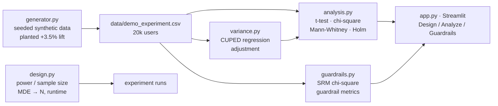

# A/B Test Analysis Toolkit

[](https://www.python.org/downloads/)
[](https://ab-test-analysis-toolkit.streamlit.app)
[](LICENSE)
[](#testing)

An industry-level A/B testing toolkit: generate synthetic experiment data with **known planted effects**, size experiments correctly with power analysis, and analyze results with production-grade statistics — beyond a naive t-test on two means. Ships as a Python library plus an interactive Streamlit demo.

Most portfolio projects stop at EDA. Experimentation teams at e-commerce and SaaS companies live on a different skill set: CUPED variance reduction, sample-ratio-mismatch detection, guardrail monitoring, and honest multiple-testing corrections. This toolkit implements that workflow end to end.

## Architecture



## Features

- **Synthetic data generator** (`generator.py`) — deterministic numpy Generator (fixed seed), 20k users, control/treatment arms, 3 segments (new/returning/mobile), pre-period spend covariate, revenue + conversion outcomes, guardrail columns (bounce, pageviews). Planted ground truth: **+3.5% revenue lift on returning users, null elsewhere**. `--tamper` flag injects a sample-ratio mismatch for the guardrail demo.
- **Experiment design** (`design.py`) — two-sample power/sample-size calculators (proportions and means, normal approximation), unequal allocation ratios, runtime estimates from daily traffic, cross-validated against statsmodels.
- **Analysis** (`analysis.py`) — Welch's t-test, chi-square two-proportion test, Mann-Whitney U, Holm and Bonferroni corrections. Every test returns effect size, CI, p-value and relative lift in one dataclass; per-segment drilldown with Holm adjustment.
- **CUPED variance reduction** (`variance.py`) — regress post-period revenue on the pre-period covariate and test the residuals. On the demo data this cuts the confidence-interval width substantially and turns a borderline result into a clean detection.
- **Guardrails** (`guardrails.py`) — SRM chi-square check against the intended allocation (alpha=0.01), guardrail-metric comparisons (bounce, pageviews) with Holm correction and a hard-fail banner when SRM fails.
- **Streamlit app** (`app.py`) — three sections: **Design** (size the experiment), **Analyze** (naive vs CUPED side by side, segment drilldown), **Guardrails** (SRM + health metrics on clean vs tampered data).

## Quickstart

```bash
# 1. install
pip install -r requirements.txt

# 2. generate the demo dataset (deterministic; 20k users)
PYTHONPATH=src python data/make_demo.py
# inject SRM for the guardrail demo:
PYTHONPATH=src python data/make_demo.py --tamper --out data/demo_experiment_tampered.csv

# 3. run the tests
PYTHONPATH=src pytest -q

# 4. launch the app
PYTHONPATH=src streamlit run app.py
```

Library usage:

```python
from abtoolkit import generator, design, analysis, variance, guardrails

df = generator.generate_experiment(n_users=20_000, seed=42)

# size it first
plan = design.sample_size_proportions(p1=0.12, mde_relative=0.05, daily_traffic=5000)
print(plan.n_control, plan.n_treatment, plan.runtime_days)

# naive vs CUPED
naive = analysis.analyze_metric(df, "revenue")
cuped, diag = variance.cuped_ttest(df, "pre_spend", "revenue")
print(f"CI width shrank by {1 - cuped.ci_width / naive.ci_width:.1%}")

# trust checks before reading results
print(guardrails.srm_check(df).passed)
print(guardrails.guardrail_checks(df))
```

Or with Docker:

```bash
docker build -t ab-test-analysis-toolkit .
docker run -p 8501:8501 ab-test-analysis-toolkit
```

## Project structure

```
ab-test-analysis-toolkit/
├── src/abtoolkit/
│   ├── __init__.py
│   ├── generator.py      # seeded synthetic experiment data, planted effects
│   ├── design.py         # sample-size / power, allocation, runtime estimates
│   ├── analysis.py       # t-test, chi-square, Mann-Whitney, Holm/Bonferroni
│   ├── variance.py       # CUPED variance reduction
│   └── guardrails.py     # SRM check, guardrail-metric monitoring
├── data/
│   └── make_demo.py      # writes data/demo_experiment.csv (git-ignored)
├── app.py                # Streamlit: Design / Analyze / Guardrails
├── tests/
│   ├── conftest.py
│   └── test_analysis.py  # 11 tests incl. CUPED CI-shrink and SRM flag/pass
├── requirements.txt
├── Dockerfile
├── .gitignore
└── README.md
```

## Testing

`pytest` (11 tests, all deterministic via fixed seed):

- CUPED shrinks the CI width vs the naive t-test on demo data
- CUPED detects the planted +3.5% lift on returning users (estimate within 2pp)
- Null segments (new, mobile) show no significant lift
- SRM check flags the tampered dataset and passes the clean one
- Guardrail metrics stay quiet on clean data
- Sample size decreases with larger MDE; means formula matches statsmodels within 5%
- Runtime-day arithmetic and input validation
- Holm correction rejects only the strong signal; drilldown flags nothing for conversion

## Production extensions

Ways this would grow into a real experimentation platform component:

- **Sequential testing** — always-valid p-values / mixture SPRT so teams can peek without inflating false positives.
- **Stratified CUPED / CUPAC** — ML-based covariate adjustment (gradient boosting on pre-period features) for larger variance reduction.
- **Dimension-aware SRM** — run the SRM check per segment/device/browser to localize assignment bugs.
- **Experiment assignment service** — deterministic hashing (e.g. murmur3 on user_id) so variant assignment is reproducible and auditable instead of RNG-based.
- **Metric definitions layer** — a YAML metric registry (numerator/denominator, filters, winsorization rules) so every analysis uses identical definitions.
- **Heterogeneous treatment effects** — causal forests / uplift slices beyond the fixed three segments.

## Live demo

**https://ab-test-analysis-toolkit.streamlit.app**

(The app loads the demo dataset automatically if `data/demo_experiment.csv` is absent, so the deployed demo works without committing data.)

## License

MIT
